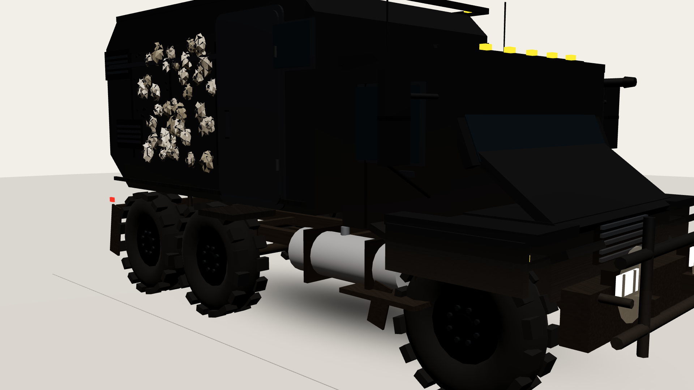
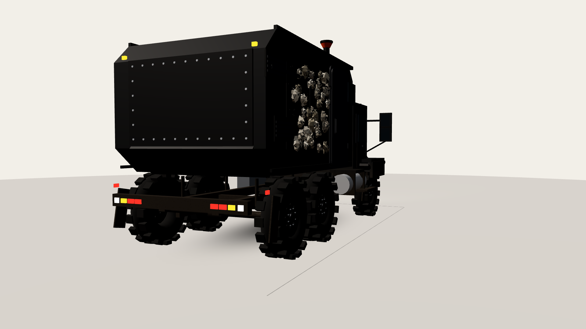
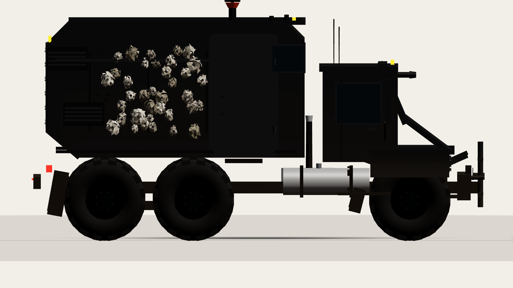
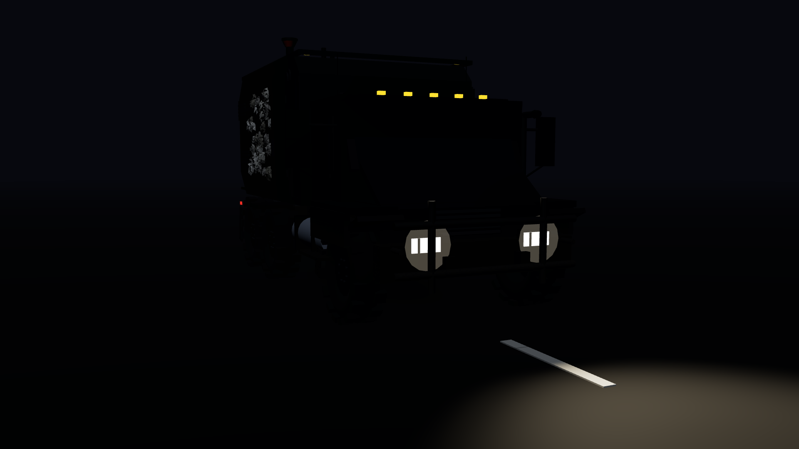

# ARK RUNNER v2

[](https://github.com/ClosedLadder/ark-runner-v2/actions/workflows/ci.yml)
[](https://opensource.org/licenses/MIT)

Procedural **Three.js** expedition truck for [ARK RUNNER v2](https://github.com/ClosedLadder/ark-runner-v2)—a browser-based driving game rebuilt in 3D with an AI-assisted dev fleet. **This public repository contains the truck model and a camera preview harness**, not the complete playable game loop.

## What you get here

| Piece | Path | Purpose |
|-------|------|---------|
| ARK truck rig | `src/truck/ark.ts` | Fully procedural 6×6 matte-black expedition truck (no external models) |
| Preview harness | `src/preview.ts` | Static/turntable viewer with multiple camera presets |
| Review stills | `screenshots/` | Eight PNG plates (front, 3/4, side, rear, top, low chase, night) |
| Capture helper | `capture.mjs` | Headless screenshot script (Puppeteer; path is machine-specific) |

The truck exposes a small visual API—`setSteerVisual`, `setSpeedVisual`, `setDamageVisual`, `bump`—used by the preview and intended for the full game loop elsewhere.

## Screenshots

Review stills ship in `screenshots/`:

| | |
|---|---|
|  |  |
|  |  |

See `screenshots/` for all eight angles.

## Quick start

```bash
npm install --no-audit --no-fund
npm run dev      # http://127.0.0.1:5179
npm run build    # typecheck + Vite build → dist/
npm run typecheck
```

Open the dev URL with query parameters to change the view:

| Parameter | Values | Effect |
|-----------|--------|--------|
| `shot` | `front`, `front34`, `side`, `rear`, `rear34`, `top`, `chase`, `night` | Camera preset (default `front34`) |
| `turntable` | `1` | Slow orbit animation |
| `clean` | `1` | Hide debug HUD |
| `hull` | `0`–`1` | Damage / wear amount (1 = fresh) |
| `steer` | `-1`–`1` | Steering visual (wheels + body roll) |
| `rpm` | `0`–`1` | Wheel spin and suspension bob |

Examples:

- `http://127.0.0.1:5179/?shot=chase`
- `http://127.0.0.1:5179/?shot=night&clean=1`
- `http://127.0.0.1:5179/?turntable=1`

There is **no keyboard driving** in this slice—the preview is for model and camera review.

## Camera presets

The preview harness implements the framing called out in the v2 design:

- **3/4 front** (`front34`) — hero marketing angle
- **3/4 rear** (`rear34`)
- **Low chase** (`chase`) — rear perspective similar to the planned in-game chase camera
- **Night** (`night`) — headlights on, fog, dash lane markers
- **Orthographic reference** — `front`, `side`, `rear`, `top`

Architecture notes: [`docs/adr/002-chase-and-preview-cameras.md`](docs/adr/002-chase-and-preview-cameras.md)

## Procedural truck details

Built entirely in TypeScript + Three.js:

- Merged paint / glass / trim material groups
- 256×256 canvas roughness atlas (boot-time)
- Six instanced wheels (shared tire + rim geometry)
- Two SpotLights for headlight cones
- Budget guard: ≤ 25k triangles, ≤ 25 draw calls (checked when the truck is constructed; exceeding it throws)
- Damage: vertex dents, dust tinting, atlas wear, lamp flicker at low hull

No glTF, PNG, or audio files are loaded.

## Tech stack

- [Three.js](https://threejs.org/) 0.170.0
- [Vite](https://vitejs.dev/) 5.4
- TypeScript 5.6 (strict)
- Target: ES2022, static `dist/` output (`base: './'`)

## What this is / isn't

**This is:**

- A real, runnable slice from an AI-assisted game rebuild (truck module + review tooling)
- Honest procedural 3D work with enforced GPU budgets
- Source you can `npm run dev` and inspect in the browser today

**This isn't:**

- The full ARK RUNNER v2 driving game (highway world, hazards, scoring, menus, audio, and input are **not** in this repo)
- A commercial or itch.io release
- A claim about National Parks landmark modules—those are not present in this extracted source

The broader v2 project targeted a night-desert highway driving game with chase camera and procedural environments; see [`docs/adr/`](docs/adr/) for architectural decisions. [`RELEASE-NOTES.md`](RELEASE-NOTES.md) lists what shipped in v1.0.0 of this portfolio package.

## Project layout

```
ark-runner-v2/
  src/
    truck/ark.ts      # procedural truck
    preview.ts        # camera harness (entry)
  screenshots/        # review PNGs
  docs/adr/           # architecture decision records
  capture.mjs         # headless still capture
  index.html
  vite.config.ts
  package.json
```

## License

MIT — Copyright (c) 2026 Steven Haller. See [LICENSE](LICENSE).
